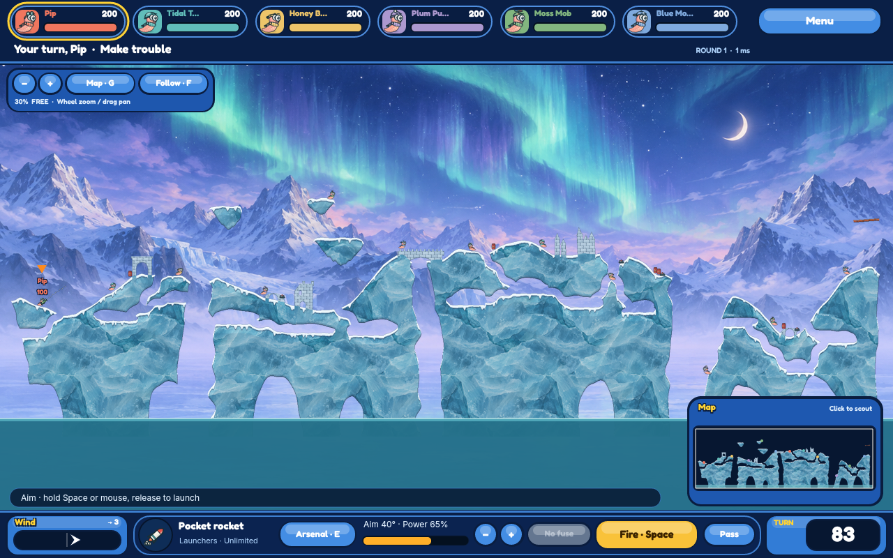

# scarpe-worms · Burrow Brigade

An original desktop artillery game built with [Scarpe](https://github.com/scarpe-team/scarpe)'s native renderer.
Up to six teams, destructible random maps, 48 weapons and tools, and self-hosted online play.



**Status: 0.5.5 preview.** The first downloadable release, with clients for macOS
(Apple silicon), Windows and Linux and a Docker image for the server. 0.5.4 removed
the host stall at every crater and made matches start a second faster. 0.5.3 made
grubs squeak when hit, call for a medic, say "buh-bye" and pop into a little ghost,
leaving their team's gravestone; big hits land with comic POW!, BONK! and KABOOM!
bursts, and sheep baa while cows moo.
0.5.2 reworked all 48 weapons, and 0.5.0 brought organic islands with caves, overhangs, sea
arches and ruins; blasts that fling grubs, mines and barrels; spreading fire; and
two-step weapons such as a homing rocket you lock on, then aim and charge. This builds
on 0.4.0's painted environments and the glossy arcade interface
([screenshots](docs/evidence/README.md)). The clients are unsigned previews: expect
Gatekeeper and SmartScreen prompts, and human acceptance remains before a sales release.
See [current status and next work](docs/STATUS.md).

## Download and play

Download **Burrow Brigade** for **Apple silicon macOS**, **Windows x64** or
**Linux x86-64** from [GitHub Releases](https://github.com/AliOsm/scarpe-worms/releases).
The clients include Ruby and the native renderer; no development setup is needed.
The release notes cover installation, unsigned-app prompts and SHA-256 hashes.

Each release also includes Docker images for **Linux amd64 and ARM64** and a
ready-to-use Compose file for hosting your own server; see [Hosting](docs/HOSTING.md).

## Run from source

Install Ruby 3.4+, Bundler, Rust via rustup, Python 3.12+, and Git.
[Development setup](CONTRIBUTING.md) lists the platform dependencies.

```sh
git clone https://github.com/AliOsm/scarpe-worms.git
cd scarpe-worms
./setup.sh
./run.sh
```

Setup downloads pinned Scarpe source, applies the independent patches, installs
gems, and builds the native renderer. No sibling prototype repo is needed.

To build the clients yourself, follow the [macOS](docs/MACOS.md), [Windows](docs/WINDOWS.md)
and [Linux](docs/LINUX.md) guides.
App bundles and ZIPs are build artifacts, not files in the source checkout.

## Play

- **Quick battle:** play against bots or resume an unfinished local match.
- **Create a match:** choose seeds, terrain, biome, world size, rules, and ammunition.
- **Play with friends:** host a room, join a server, or paste an invite.

| Action | Control |
| --- | --- |
| Move / jump / backflip | A/D or arrows · W/Enter · B |
| Aim / fire | Mouse · hold/release Space for throws; tap for guns and tools |
| Homing rocket | Click to lock a target, then aim and hold/release · Backspace re-targets |
| Air strike approach / girder tilt | ← → (A/D still walk) |
| Arsenal / fuse / chat | E · 1–5 · T |
| Overview / follow / zoom | G · F · Q/R or mouse wheel |
| Pan / menu | Middle-drag or minimap · Escape |

Wheel zoom stays under the pointer; dragging or scouting leaves the camera in
manual mode until **F / Follow**. The on-screen hint explains each weapon's
stages. See the [weapon guide](docs/WEAPONS.md).
Hosts and clients must use **protocol 4** together.

## Host online

Each release ships `compose.yaml` and loadable server images; from a checkout you
can also build the image yourself:

```sh
docker compose up -d --build
docker compose logs burrow
```

Share the reachable host, port **4388/TCP**, room code, and certificate fingerprint.
The host saves matches and supports reconnects. [Hosting](docs/HOSTING.md) covers
port forwarding, deploying to a server from GitHub Actions on a `v*` tag, direct
Ruby, systemd, TLS, and backups.

## Develop

```sh
bundle exec rake test
./bin/check-native
```

- [Contributing](CONTRIBUTING.md) — setup, focused checks, and changes to Scarpe.
- [Agent guide](AGENTS.md) — where to start and invariants to preserve.
- [Documentation index](docs/README.md) — architecture, art, validation, and release work.

MIT licensed; see [LICENSE](LICENSE) and [third-party notices](THIRD_PARTY.md).
Burrow Brigade is independent and contains no Team17 game assets or code.
